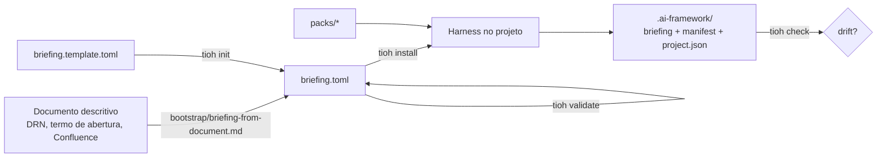

# Tio Harness

Framework de **IA agêntica com SDD** (Specification-Driven Development). A partir de um **briefing** — escrito à mão ou gerado de um documento descritivo — ele
**instala** num projeto todo o harness que faz agentes (GitHub Copilot, Claude Code, Gemini CLI,
Warp/Oz, Codex) trabalharem ancorados em fonte oficial, sem alucinar regra de negócio:

- `AGENTS.md` (fonte única de verdade) + ponteiros `CLAUDE.md`, `GEMINI.md`, `WARP.md`, `.github/copilot-instructions.md`;
- fluxo SDD `specify → plan → tasks → review` (prompts canônicos + comandos por agente + template de spec);
- skills de implementação com gates humanos: `source-intake`, `implementation-loop`, `test-quality-loop`,
  `review-handoff` (+ `tl-review`, `architecture-advisor`, `meeting-intake`, `hexagonal-module`, `qa-playwright-scenario` por pack);
- scripts de sincronia Confluence/Jira (publicar specs, changeset idempotente, índice de páginas);
- estado de instalação versionável (`.ai-framework/`) com detecção de drift.

## Requisitos
Python **3.11+** (só biblioteca padrão). Node apenas para o pack `md2html`.

## Uso rápido
```bash
# 1a. briefing em branco…
python3 bin/tioh.py init briefings/meu-projeto.briefing.toml
# 1b. …ou gerado a partir de um documento (no agente): /tioh-bootstrap  (Copilot)  ·  /tioh:bootstrap  (Claude Code)

python3 bin/tioh.py validate briefings/meu-projeto.briefing.toml
python3 bin/tioh.py install  briefings/meu-projeto.briefing.toml ~/Projects/meu-projeto --dry-run
python3 bin/tioh.py install  briefings/meu-projeto.briefing.toml ~/Projects/meu-projeto
python3 bin/tioh.py check    ~/Projects/meu-projeto        # sai 1 se houver drift
```

Exemplo completo (fictício): [`examples/gestor-pedidos.briefing.toml`](examples/gestor-pedidos.briefing.toml).

## Como funciona


- **Packs** (`packs/<nome>/`): `pack.toml` + árvore `files/` espelhando o destino. `core` é sempre instalado.
  Liste com `python3 bin/tioh.py packs`.
- **Templates:** arquivos `*.tmpl` são renderizados com o briefing (sintaxe em [briefing/SCHEMA.md](briefing/SCHEMA.md)).
- **Reinstalação segura:** o manifesto guarda o hash do que o framework escreveu. Arquivo intocado é
  atualizado; arquivo **editado no projeto** não é sobrescrito — a versão nova vai para `<arquivo>.tioh-new`
  (`--force` sobrescreve). Arquivos que saíram do framework são listados como obsoletos (`--prune` remove os intocados).
- **Claude Code:** com `claude` em `agents.targets`, as skills são espelhadas em `.claude/skills/`.

| Pack | Instala |
|---|---|
| `core` | AGENTS.md, ponteiros, prompts SDD, comandos por agente, templates, skills base, `install-agent-skills.sh` |
| `atlassian` | `CONFLUENCE-SYNC.md`, MCP (`.mcp.json`, `.vscode/mcp.json`), scripts REST parametrizados pelo briefing; opcional `atlassian.mirror`: documentos do projeto espelhados em páginas do Confluence (`sync-mirror.py`) |
| `architecture-advisor` | skill que sugere alternativas de arquitetura avaliadas contra as diretrizes corporativas, como apoio aos arquitetos |
| `meeting-intake` | skill que processa transcrições e atas de reunião: cruza com as perguntas em aberto, separa decisão de indicação, registra a ata e propõe respostas (gate humano) |
| `tl-review` | skill de revisão de Tech Lead com merge e baixa no Jira (glab/gh) |
| `java-spring-hexagonal` | skill `hexagonal-module` (business/port + adapter/*) |
| `playwright-qa` | skill `qa-playwright-scenario` |
| `parallel-lanes` | subagente `lane-executor` (Claude Code) para worktrees |
| `md2html` | conversor Markdown → HTML autocontido |

## Princípios
1. **Não alucinar** — sem fonte, `⚠️ A DEFINIR`/`⚠️ PENDÊNCIA`; nunca valor plausível.
2. **Fonte viva > cópia local** — cadeia de fallback de acesso, gate de referência antes de codar.
3. **Gate humano** para toda ação externa/irreversível (push, MR, merge, transição, publicação).
4. **Rastreabilidade 1:1** spec ↔ itens de trabalho ↔ código.
5. **Sem atribuição a agentes** em artefatos (configurável em `rules.no_agent_attribution`).

## Estrutura
```text
bin/tioh.py                      CLI (init, validate, packs, install, check) + motor de templates
briefing/                       template e esquema do briefing
bootstrap/                      prompt canônico documento → briefing
examples/                       briefing de referência fictício (Gestor de Pedidos)
packs/<nome>/{pack.toml,files/} capacidades instaláveis
briefings/                      briefings dos projetos atendidos (somente locais, ignorados pelo Git)
.agents/skills/framework-bootstrap   skill para operar o framework via agente
```

## Evoluir o framework
Melhoria nascida num projeto (ex.: ajuste numa skill) deve voltar ao pack correspondente aqui, de forma
genérica (campo novo no briefing, se preciso). Depois: `validate` no exemplo, `install --dry-run` num
diretório temporário e conferir que não sobra `@@` no resultado. Ver [AGENTS.md](AGENTS.md).
